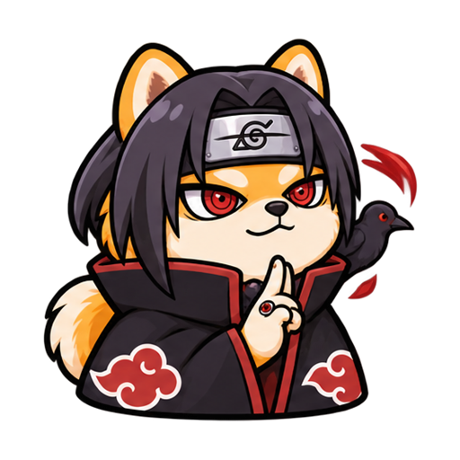

# DogeIcons

一套给游戏插件和界面装饰用的橘色柴犬贴纸。圆脸、大表情和粗描边贯穿整个系列，从戴探险帽挥手，到换上红云袍扮成晓组织成员，每张都可以单独取用。

| 系列 | 数量 | 内容 |
| --- | ---: | --- |
| 探险柴犬 | 8 | 招手、笑出泪、指南针、打瞌睡等 |
| 变装柴犬 | 8 | 海盗、魔法师、厨师、宇航员、忍者、骑士、侦探和摇滚歌手 |
| 新变装柴犬 | 4 | 冰霜炼金师、提灯贺岁、森林德鲁伊和复古电玩 |
| 晓组织柴犬 | 6 | 宇智波鼬、佩恩、小南、干柿鬼鲛、迪达拉和阿飞 |
| 原版单张 | 7 | 游戏手柄、疑惑、心动、惊吓、墨镜读报和两款点赞 |
| 原始合集 | 2 | 探险与变装系列的原图 |

## 素材预览

   

## 下载和使用

打开图片后可下载单张，也可通过仓库的 **Code → Download ZIP** 下载全部素材。前四个系列共 26 张，统一为 **512 × 512 RGBA PNG**，图案居中并带透明边距。原版单张和原始合集保留原图规格。

如果插件要求 BLP 贴图，可先把选中的 PNG 转成 BLP，再按插件的贴图路径导入。晓组织系列为《火影忍者》同人设计。
